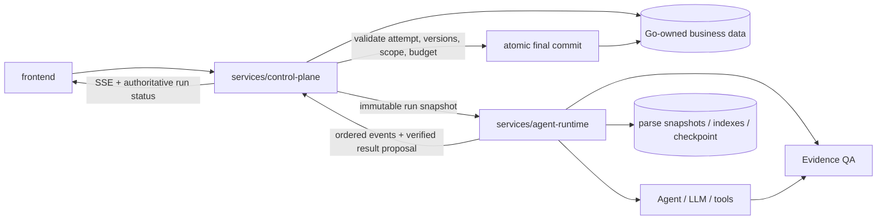

# RiskPilot 双服务架构与迁移完成记录

日期：2026-10-27。

RiskPilot 的仓库和职责迁移已经完成。`services/control-plane` 是 Go 业务控制面，也是业务数据与运行终态的唯一权威方；`services/agent-runtime` 是仅供内部调用的 Python AI 执行服务。旧服务目录和仓库根目录 Python 包不再作为运行路径，也不保留兼容副本。本文记录完成态，不是路线图。

## 当前服务边界

| 模块 | 当前职责 | 明确不负责 |
| --- | --- | --- |
| `frontend/` | 聊天、历史会话、附件、记忆、引用和运行状态界面 | 不自行判定运行成功，不持有业务真相 |
| `services/control-plane/` | Go + Gin 对外 API、认证与授权、会话/消息/记忆/文件目录、run、取消与恢复、SSE、最终消息和终态原子提交 | 不执行模型推理、RAG 或语义证据校验 |
| `services/agent-runtime/` | 接收不可变运行快照，执行 Agent、LLM、RAG、解析、索引和 Evidence QA，维护 AI checkpoint，返回有序事件与结果提案 | 不写会话、记忆、文件目录、最终消息或业务 run 终态 |
| `contracts/internal/v1/` | 服务身份、运行快照、运行事件和控制命令 JSON Schema | 不承载浏览器直接调用合同 |
| `docs/` | 架构、验证、指南、评测说明、法规索引和作品集文档 | 不保存运行数据 |

Go 和 Python 各自保持清晰分层。`services/control-plane/internal/{api,app,domain,infra}` 承载业务用例与数据所有权；`services/agent-runtime/{api,app,domain,infra}` 只承载内部 AI 执行，`ingestion/`、`processing/`、`retrieval/` 负责材料计算与检索流水线。

## 请求与提交路径



浏览器只访问 control plane。Go 从已验证会话确定 owner，创建用户消息与 run，固定附件版本、记忆 revision、上下文和预算，再把符合 `run-execute` 合同的不可变快照交给 agent runtime。浏览器不能直接选择 owner、attempt 或内部 thread。

Agent runtime 只对快照执行计算。它可以生成工具过程、解析/检索产物、候选引用、已校验答案和调用计数，但只能作为带 `run_id + attempt_id + event_seq` 的事件或结果提案返回。Python 不能直接把这些提案写成业务消息或终态。

## 业务数据与运行终态

Go control plane 是以下状态的唯一权威写入方：

- 用户、身份、权限与认证审计。
- 会话、用户消息、助手消息、反馈和附件选择。
- 账号记忆、开关、原话来源、revision、期限和复核状态。
- 文件目录、不可变版本、处理任务登记及版本有效性。
- run、attempt、幂等键、执行租约、取消/恢复状态、事件游标和预算使用量。
- 最终引用、最终助手消息与 `completed`、`cancelled`、`timed_out`、`budget_exhausted`、`failed` 等业务终态。

Python agent runtime 仅拥有 AI 执行内部状态：

- LangGraph checkpoint 与节点执行状态。
- 解析快照、检索索引、Embedding 身份和 AI 计算产物。
- 模型/工具调用中的临时上下文、候选证据和校验结果。

AI 内部状态不能替代 Go 的业务 run 状态。SSE 中的 `answer` 是 Go 完成事务后发布的持久化助手消息，但它也可能是失败时的安全说明；前端只能根据权威 `run_status` 判定成功。

## 最终结果原子提交

Python 返回已校验结果提案后，Go 在短事务中检查：

1. owner、run、attempt 和当前执行权仍匹配。
2. 运行未取消、未超时，事件序号与预算合法。
3. 引用的记忆仍存在、启用、未过期且 revision 未变化。
4. 附件和知识材料版本仍有效，引用只来自本轮授权快照。
5. 结果摘要、引用集合和 Python 校验产物属于同一输入与 attempt。
6. 原子写入最终助手消息、实际引用、使用量和业务终态。

事务中不调用模型，也不执行跨服务 RPC。任何检查失败都拒绝迟到结果；Python 不得用自己的 checkpoint 状态覆盖 Go 的业务终态。

## 内部合同

跨服务 v1 合同位于仓库根目录 `contracts/internal/v1/`：

- `service-principal.schema.json`：Go 签发给 Python 的短期服务身份声明。
- `run-execute.schema.json`：Go 构造的不可变执行快照，包括 run、attempt、消息、附件版本、记忆快照与预算。
- `run-event.schema.json`：Python 返回的有序执行事件和结果载荷。
- `run-control.schema.json`：Go 发给 Python 的当前 attempt 取消命令；恢复使用带 `resume=true` 的完整 `run-execute` 快照和新的 attempt。
- `document-process.schema.json` / `document-result.schema.json`：文件目录由 Go 持有，Python 仅接收指定版本的 ingest/delete 计算命令并返回解析、索引结果。

所有合同都显式携带 `schema_version`。重试使用新的 `attempt_id`；Go 只接受当前 attempt 的单调事件序号，旧工作者的迟到事件不能提交。

## 可信回答边界

Agent 的工具调用和自由文本只产生候选结果。正式事实回答遵循 fail-closed 链路：

1. Python 从 Go 授权快照限定的材料执行检索，并为候选证据分配稳定 `SRC-*` ID。
2. Agent runtime 回读解析快照、法规或网页来源，核对版本、范围和原文。
3. 结构化生成器把回答拆为 Claim，并且只能引用本轮候选 ID。
4. 结构校验删除未知或无引用 Claim，独立 verifier 检查语义支持且不能扩大引用集合。
5. Python 只返回可靠子集或拒答提案；Go 再验证业务版本与权限并提交最终结果。

来源校验通过的文本仍不是可信 HTML。实时回答与历史消息在前端使用同一 Markdown 清洗和安全链接规则。

## 目录结构

```text
frontend/
services/
  control-plane/
    cmd/riskpilot/
    internal/{api,app,domain,infra}/
  agent-runtime/
    api/
    app/
    domain/
    infra/
    ingestion/
    processing/
    retrieval/
    evaluations/
    scripts/
    tests/
contracts/
  internal/v1/
docs/
```

迁移后的导入、测试和脚本都以服务目录为根。Python 文件不再从仓库根目录的旧包加载；Go 构建只引用 `services/control-plane`。业务表和 AI 内部存储可以部署在同一数据卷，但使用不同数据库文件：`CONTROL_PLANE_DB_PATH` 与 `AGENT_RUNTIME_ARTIFACT_DB_PATH`，并按上述边界保持单一写入方。

## 验证原则

- 目录门禁拒绝旧服务路径和 `docs/` 外的 Markdown。
- 本地链接检查从每个 Markdown 文件所在目录解析目标，并确认目标存在。
- 合同测试证明 Go 快照、Python 事件和控制命令满足同一 schema。
- 故障测试证明取消、超时、断流、重试和迟到提案不能绕过 Go 终态事务。
- 工程回归、Fake/oracle、真实模型效果和外部 OAuth/LangSmith 联调分别报告，不能互相替代。

相关文档：[当前架构总览](overview.md)、[内部合同](../contracts/index.md)、[当前评测](../evaluations/index.md)、[简历表述](../portfolio/resume-go-version.md)。
