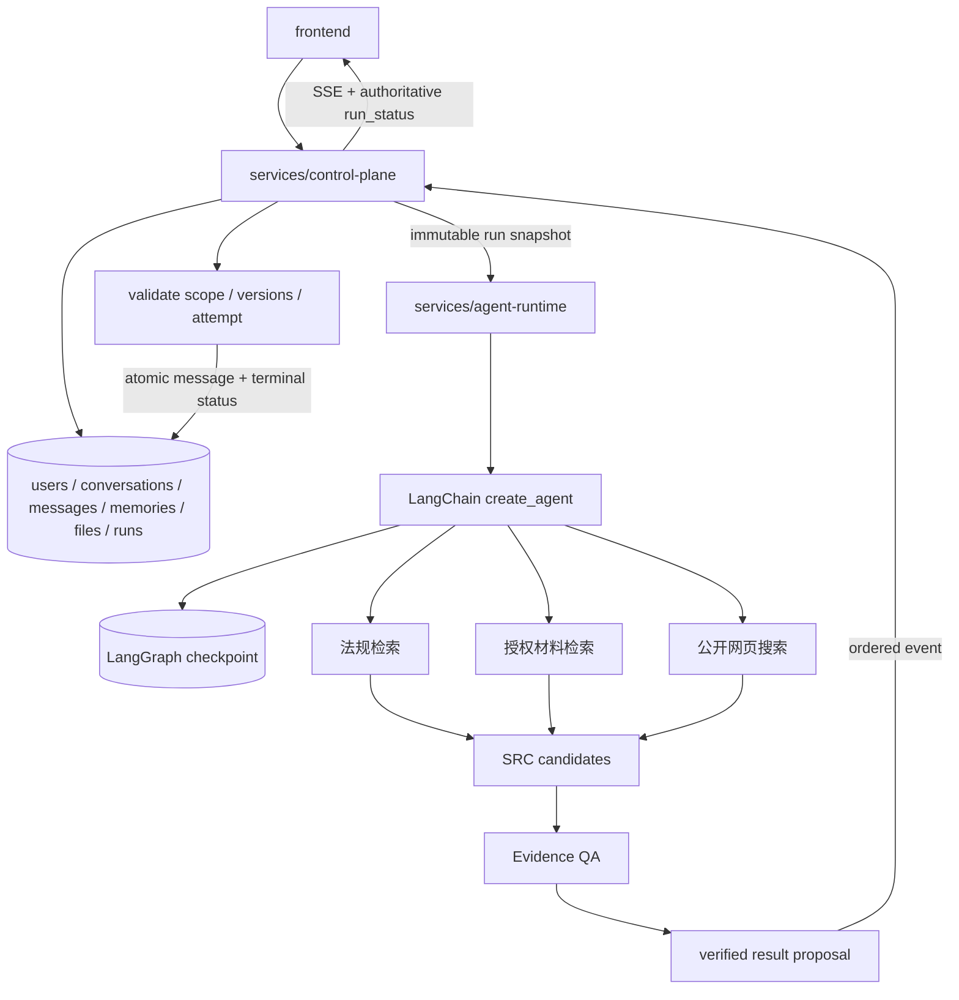

# 对话式 RiskPilot 当前架构

RiskPilot 已完成双服务迁移：`services/control-plane` 是 Go 业务控制面，拥有业务数据与运行终态；`services/agent-runtime` 是仅供内部调用的 Python AI 执行服务。旧服务目录与仓库根目录 Python 包不再是运行路径。完整所有权与迁移完成记录见[双服务边界](go-python-migration.md)。

## Go 业务控制面

`services/control-plane` 是浏览器唯一入口，也是业务状态的唯一权威写入方：

- GitHub/匿名认证、Cookie/JWT、账号与权限。
- 会话、消息、反馈、附件选择与历史读取。
- 账号记忆 CRUD、原话来源、revision、期限、复核和召回开关。
- 文件目录、不可变版本、处理任务登记与可用状态。
- run、attempt、幂等、执行权、取消/恢复、事件游标和预算。
- 最终引用、助手消息与运行终态的原子提交。
- 面向浏览器的 REST/SSE、限流、错误映射和健康状态。

Go 在调用 Python 前固定 owner、消息、附件版本、记忆快照和预算。Python 返回结果后，Go 重新校验 attempt、取消状态、记忆 revision、文件版本和引用范围；只有校验成功才写入最终消息并发布 `completed`。迟到、越权或版本失效的提案不能提交。

## Python AI 执行服务

`services/agent-runtime` 不拥有会话、记忆、文件目录、最终消息或业务终态。它只负责：

- Agent 工具决策、模型调用、查询改写和会话摘要提案。
- 解析、OCR、切块、Embedding、reranker、RAG 与索引计算。
- Evidence QA 的来源回读、Claim 结构校验和独立语义支持校验。
- LangGraph checkpoint、节点执行状态和本次 attempt 的调用预算检查。
- 向 Go 返回带 `run_id + attempt_id + event_seq` 的工具过程、候选引用、使用量和已校验结果提案。

Python checkpoint 只证明 AI 节点执行到哪里，不能证明业务成功。浏览器也不能直接调用 Python 或用内部 thread ID 恢复运行。

## 可信来源路径

Agent runtime 从 Go 授权的不可变快照执行检索，并生成稳定 `SRC-*` 候选证据：

1. 附件引用回读指定 DocumentVersion 和 parse snapshot，核对页码、SHA 和 quote。
2. 一般知识材料受 owner 与版本范围约束；法规只来自 public corpus；网页必须有实际 URL。
3. 结构化生成器把回答拆成 Claim，并且只能引用本轮候选 ID。
4. 结构校验移除无引用或未知引用 Claim；独立 verifier 检查语义支持且不能扩大引用集合。
5. Python 返回可靠子集或拒答提案；Go 复核业务版本与权限后提交最终消息。

页面展示是独立安全边界：来源和语义校验通过的文本仍不能作为可信 HTML。实时回答与历史消息使用相同的 Markdown 清洗入口，限制标签、属性和 URL 协议。

## 中断、取消与恢复

Go 拥有业务 run、attempt、取消请求和恢复权限。恢复时 Go 创建新的 attempt，重新发送带 `resume=true` 的不可变快照；Python 使用相同 `thread_id` 的 LangGraph checkpoint 继续 AI 计算。Go 只接受当前 attempt 的单调事件序号；旧执行者的迟到结果被拒绝。

正常 SSE EOF 只结束客户端传输，不自动把 run 标记为成功。`answer` 事件也不是完成证明；前端始终以 Go 发布的权威 `run_status` 为准。

## 追踪与指标

同一 `run_id` 关联 Go 业务生命周期与 Python Agent、工具、检索和引用校验 span。LangSmith 出站适配器清空正文、Prompt、附件、模型输出和原始异常，只保留白名单状态、计数、耗时及不可逆标识哈希。Provider 未返回 usage 或未配置价格时不补造 token 与费用。
